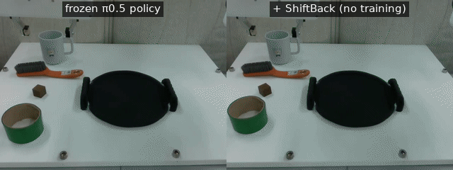
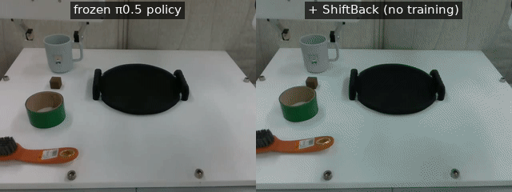
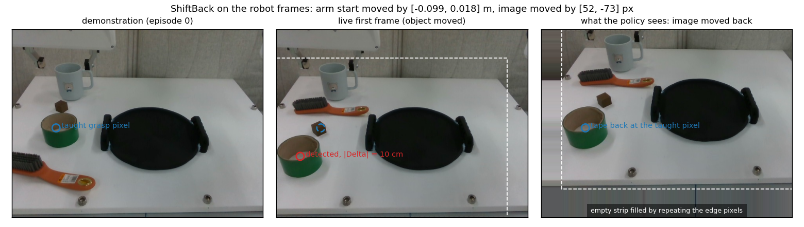
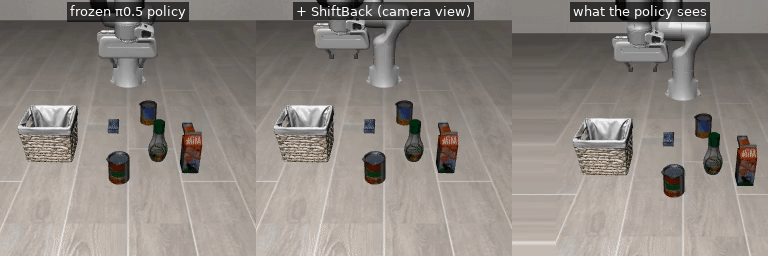

# ShiftBack

Training-free correction of workpiece layout changes for imitation-learned robot manipulation policies.

A policy taught by demonstration in one table layout fails when a part is moved: it reaches for
where the part used to be. ShiftBack keeps the policy frozen and corrects its inputs instead. One
detection on the first frame, projected onto the table at the height at which the gripper closed
in the demonstrations, gives the part's displacement. The arm starts from a pose moved by this
displacement and the fixed camera's image is moved back by it, so the policy sees the layout it
was taught in. At gripper closure the same correction is applied for the placement.

No training, no object pose, no depth camera, no hand-made label. The only calibration is the
fixed camera's, done once (on our robot it is fitted from the demonstrations themselves).

<p align="center">
<br>
<em>Tape moved 10 cm. Left: the frozen π0.5 policy closes its gripper where the tape used to be. Right: the same policy with ShiftBack.</em>
</p>
<p align="center">
<br>
<em>Tray moved 9 cm. The correction is applied again at gripper closure, for the placement.</em>
</p>

## Results

LIBERO-Pro relocation suites, success rate in percent, frozen policy → with ShiftBack. The
policy checkpoints are the released ones (π0.5, π0, OpenVLA-OFT) or trained from scratch per
suite (Diffusion Policy, ACT); ShiftBack is the same code for all of them.

| frozen policy | object | spatial | goal | long |
|---|---|---|---|---|
| π0.5 (official protocol, 50 initial states per task) | 16.2 → 74.0 | 46.2 → 69.6 | 33.8 → 49.8 | 7.4 → 16.8 |
| π0 (3 seeds) | 0 → 27 | 8 → 16 | 15 → 19 | – |
| OpenVLA-OFT | 0 → 32 | 25 → 44 | 1 → 3 | – |
| Diffusion Policy (3 seeds) | 0 → 10 | 0 → 29 | 0 → 7 | – |
| ACT | 0 → 15 | – | – | – |

Retention on the standard (unchanged) suites is within one point for π0.5 and costs one to four
points for the other policies. Every comparison is paired: the frozen and the wrapped policy see
identical initial states and identical policy noise.

Franka FR3, "put the tape on the plate", π0.5 fine-tuned on 40 demonstrations, successes out of 10:

| layout | frozen π0.5 | with ShiftBack |
|---|---|---|
| demonstrated | 5 | 7 |
| tape exchanged with the brush (moved ~10 cm) | 1 | 7 |
| tray moved 9 cm | 0 | 7 |

## Running it

**Without a GPU, a few seconds.** The whole computation on recorded robot frames: the shipped
projection matrix, the anchors from the 40 demonstrations, the first frame of a trial in which the
tape had been moved and the detections OWLv2 gave on it.

```bash
pip install -r requirements.txt            # numpy, pillow and matplotlib are enough for this part
python demos/00_shift_back_no_gpu.py       # object moved 10 cm
python demos/00_shift_back_no_gpu.py --scene tray_moved
python -m pytest tests                     # checks the core against the numbers the robot used
```

<p align="center"></p>

**With one GPU, about half an hour.** A frozen π0.5 on one LIBERO-Pro task, with and without
ShiftBack, paired on identical initial states and policy noise, with videos of what the policy saw.
[docs/REPRODUCE.md](docs/REPRODUCE.md) describes the one-time set-up (openpi, LIBERO-Pro).

```bash
# terminal 1, in the openpi checkout: serve the released checkpoint
uv run scripts/serve_policy.py --port 8000 policy:checkpoint --policy.config pi05_libero --policy.dir gs://openpi-assets/checkpoints/pi05_libero
# terminal 2
python sim/eval_paired.py --suite libero_object_swap --task-ids 0 --trials 5 --port 8000 --save-videos --out outputs/smoke
```

<p align="center">
<br>
<em>Output of that command. Left: frozen π0.5. Middle: the same policy with ShiftBack. Right: the shifted frame the policy receives; the vacated strip is filled with the edge pixels.</em>
</p>

**Full reproduction.** `sim/run_paired.sh` runs the relocation and retention suites under the
official protocol; the switches of `sim/eval_paired.py` give the ablation rows, the localiser-noise,
threshold and calibration-error sweeps. [docs/REPRODUCE.md](docs/REPRODUCE.md) lists the command for
every table. For the robot side see [docs/REAL_ROBOT.md](docs/REAL_ROBOT.md).

## Contents

```
shiftback/          the method, pure numpy (torch and transformers only for the localiser)
  geometry.py       pixel <-> table-plane points through the fixed camera; calibration from correspondences
  anchors.py        grasp and release anchors from the gripper events of the demonstrations
  shift.py          the image shift with edge filling; the minimum-shift threshold
  localiser.py      phrase extraction from the instruction; OWLv2 as a phrase -> pixel localiser
  planner.py        first-frame detections -> start-pose shift, image shift, carry at closure
demos/              the no-GPU demo
sim/                LIBERO / LIBERO-Pro: paired evaluation, anchor and localiser-pixel tables, statistics
localiser/          fine-tuning OWLv2 as a point localiser on the demonstrations (benchmark only; the robot uses it zero-shot)
real/               Franka kit: calibration from demonstrations, anchors, detection service, episode runner
data/real_sample/   40 demonstration first frames and gripper logs, 25 clicked calibration frames, 3 recorded trials
data/libero/        the anchor and localiser-pixel tables behind the numbers above
```

The two fine-tuned OWLv2 checkpoints used on the benchmark (grasp point and release point) are on
the [Releases](https://github.com/ThoughtToTorque/ShiftBack/releases) page. `sim/eval_paired.py`
runs from the shipped pixel tables without them.

## Using the library

```python
from shiftback import ShiftBackPlanner, load_projection

P = load_projection("data/real_sample/calib/P.npy")               # fixed camera, robot base -> pixel
planner = ShiftBackPlanner(P, grasp_uv=[112, 252], grasp_z=0.066,   # where the gripper closed in the demonstrations
                           release_uv=[365, 279], release_z=0.082, tau=0.04)
plan = planner.plan(det_obj={"uv": [60, 324]}, det_place={"uv": [366, 280]})   # one detection on the first frame
plan.pick.delta      # [-0.099, 0.018, 0]: move the arm's start pose by this (metres)
plan.pick.duv        # [52, -73]: move every fixed-camera frame by this (pixels)
plan.carry           # [0.099, -0.018, 0]: carry the held object by this at gripper closure
frame_for_policy = planner.shift_frame(frame, "pick")
```

`real/run_episode.py` and `sim/eval_paired.py` are the two complete loops around this.

## Citation

The paper is under review; the reference will be added here.

## License

MIT. OWLv2, openpi and LIBERO are used under their own licences.
